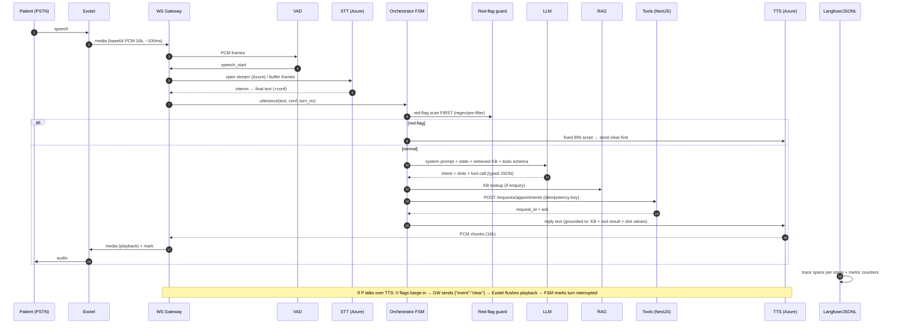

# ARCHITECTURE_DECISION_RECORD.md

**Project:** EMMA-style modular telephone voice agent — 10-day prototype.
**Operating constraint:** modular pipeline (no opaque speech-to-speech API), 10 days, ≤ ₹500 personal spend, laptop-only CPU dev, providers swappable.
**All costs/free tiers verified from provider official docs/automation quotes as dated in text (Nov 2026).**

---

## 0. Reference architecture (overview)

```mermaid
flowchart TB
  subgraph BOUNDARY["Telephony & tunnels (public internet)"]
    P["Patient's phone (PSTN)"] --> EX["Exotel Exophone<br/>Voicebot applet (bidirectional)"]
  end

  subgraph VOICEAGENT["Service 1 — emma-voice-agent (Python · FastAPI · Docker)"]
    WS["Media WebSocket Gateway<br/>(AgentStream protocol)"] --> AUD["Audio Nibble: decode/base64<br/>PCM 16k mono → frames"]
    AUD --> VAD["Silero VAD (onnxruntime, CPU)<br/>endpointing + barge-in gate"]
    VAD -- utterance frames --> STT["Azure Speech STT F0<br/>(streaming, interim→final)"]
    STT --> ORCH["Conversation Orchestrator<br/>deterministic FSM + session store"]
    ORCH <--> SAFETY["Red-flag pre-filter<br/>(regex/keyword, pre-LLM)"]
    ORCH <--> LLM["LLM client (adapter)<br/>Gemini ▸ fallback: Groq Llama / Azure OpenAI"]
    ORCH <--> RAG["RAG retriever<br/>MiniLM embeddings → Qdrant Cloud"]
    ORCH -- "tool calls (typed JSON)" --> TOOLS["Tool router"]
    TOOLS --> NEST["Service 2 — practice-backend<br/>NestJS REST + MySQL"]
    ORCH --> TTS["Azure Neural TTS F0<br/>(streaming chunks)")
    TTS --> PLAY["Playback adapter<br/>+ send clear (barge-in)"]
    WS -- base64 PCM --> PLAY
  end

  subgraph EB["Edge / egress"]
    CFT["Cloudflare Tunnel<br/>(public wss:// to laptop)"]
    EX <== "wss:// + base64 PCM 100ms chunks" ==> CFT <====> WS
  end

  subgraph OBS["Observability"]
    ORCH & STT & LLM & RAG & TTS --> LF["Langfuse Cloud (Hobby)<br/>traces: turn/stage latencies, tokens, tool calls"]
    ORCH --> JSONL[("append-only audit<br/>JSONL per call")]
  end

  NEST --> DB[(MySQL)]
  subgraph HUB["Hub — Next.js + TS (Service 3 = thin UI client)"]
    HUBUI["EMMA-Hub dashboard<br/>calls · transcripts · requests · red-flags · latency board"] --> NEST
  end
```

**Why one FastAPI process, not many microservices:** the JD asks for microservices/distributed-systems *capability* and names the **NestJS/Python split**; a 10-day prototype that must show the full voice path live. The voice agent is one process with internal module boundaries (gateway / audio / VAD / orchestrator / adapters); the practice backend is a deliberately separate NestJS service speaking a strict REST contract — that is the seam through which all request-integration happens, and it demonstrates the integration discipline the JD asks for (ADR-006).

---

## 1. Architecture Decision Records (concise)

### ADR-001 Telephony: Exotel trial (primary vs. Twilio/Plivo/manual)
- **Role:** PSTN entry point (real patient channel), streaming media bridge, call leg/CDRs.
- **Decision:** Exotel **trial account → Exophone + Voicebot applet** (bidirectional WebSocket). Fallback for evaluator entry (no KYC): scripted-replay WebSocket test harness (see ADR-010) so full evaluation never depends on telephony.
- **Verified traits** [Exotel developer docs, Nov 2026]: WS events `connected/start/media/dtmf/mark/clear/stop`; audio **raw/slin 16-bit LE mono PCM, base64**, chunks 3.2–100 KB (multiples of 320 B) ≈ every ~100 ms; **8 / 16 / 24 kHz** selectable via `?sample-rate=16000`; extended applet config: `MediaFormat` (mulaw 8 kHz default; `audio/L16;rate=16000`), `Track=inbound`, `SilenceTimeout/SilenceAction`, DTMF handling; ≤60-min stream; `clear` event flushes playback (barge-in principal); outbound "Connect Voice AI" API requires account enablement; status callbacks per leg.
- **Why it fits:** Indian origin numbers (candidate + evaluators in India), TRAI-clean Indian number, INR billing (no FX), official WS media protocol **and an official no-phone test simulator repository** (exotel/voice-streaming, Agent-Stream echo bot), real bidirectional media.
- **Free tier:** trial account = **₹1,000 in credits** to test inbound/outbound without upfront payment; trial requires **KYC activate** (missed-call verify) and a company-ish signup. `[V] docs.exotel.com/create-a-trial-account`
- **Limitations:** KYC/PAN-class steps on signup; Connect Voice AI may need enablement; trial credits consumed by daily Exophone rental — watch expiry; India-only for trial contexts.
- **Complexity:** Moderate — one WS server + applet config.
- **Cost:** ₹0 within trial credits (≈ ₹0.30–0.50/min inbound typical afterwards; irrelevant to budget under trial).
- **Rejected:** Twilio (strong API but no Indian-number program for inbound test lines at this budget/verification level; ₹ complexity), Plivo (similar), Vox bay/simulators-only (loses the real-PSTN credibility the demo deserves).

### ADR-002 STT: Azure Speech SDK (F0) streaming — with Deepgram as swap adapter
- **Decision:** Azure Speech **F0** for streaming STT + streaming TTS. Deepgram recommended spill-over if any Azure credit obstacle appears (see risk register).
- **Why:** JD names **Azure Cognitive/Services** explicitly; F0 free tier covers the demo: **5 audio-hours STT/month, 0.5 M characters TTS/month**, 1 concurrent connection on F0 (fine for solo-call demos; soak test uses replay files `instead of` concurrent F0 sockets).
- **Key mechanics:** streaming recognition over WS with interim→final per utterance segments; en-IN/en-GB models; language auto-detect optional.
- **Alternatives:** **Deepgram Nova-3** streaming (~$0.0048–0.0078/min streaming; **$200 free credit, no card needed, no expiry** — best-value fallback; used silently via adapter if chosen), AssemblyAI ($50 credit), Groq Whisper (free ~2,000 req/day but **non-streaming** file STT with 10-s minimum, so unsuitable as the live streaming engine).
- **Cost:** ₹0 during demo (F0). Credit guard: keep total demo STT well under 5 h (~2 h trial call budget ≈ 60×2-min calls).

### ADR-003 TTS: Azure Neural TTS (F0), single en-GB voice: same adapter pattern as STT
- **Decision:** Azure Neural TTS within the same F0 Speech resource (streaming output; PCM 16k mono; TTS text templates have **digits expanded / numbers normalised** to keep £/durations narrations clean for STT loop).
- **Voice:** one consistent `en-GB` neural voice (calm receptionist tone), SSML-lite (breaks, sentence splitting). Match NINA/EMMA tone: plain, kind, no roleplay language.
- **Alternatives:** **ElevenLabs** free tier = 10 k credits/month ≈ **10 min** of audio (`[V]` vendor pages) — too tight to run eval loops through, fine as a side-by-side demo clip; **Deepgram Aura-2** ($0.015–0.03/1K chars, inside the $200 credit) — quality fallback; **OpenAI TTS** simple but not free.
- **Limits:** F0 TTS ~**20 requests/minute** (one request per response turn is fine), 1 concurrent stream on F0; keep SSML simple.

### ADR-004 LLM: Gemini API primary (free tier), adapters for Azure OpenAI / Groq
- **Decision:** **Gemini 2.5/3-flash-class model via google-genai SDK**, cost-optimised; the FSM decides **when a model call happens at all** (deterministic states don't burn tokens) — only "understanding + reply + tool-selection" turns call the LLM.
- **Why:** free tier exists today (verify daily RPD on the day-of-run — Google has cut free quotas during 2025 (community reports: Flash 250 → ~20 RPD) and the pricing docs currently show promo pricing *through Dec 31, 2026* on some models); caching-friendly tool schemas; Python SDK mature. **Model-agnostic adapter** is mandatory.
- **Fallback ladder (session-adapted):** Azure OpenAI (gpt-4.1-mini-class) inside the **$100 Azure for Students credit** (≈ thousands of demo turns for ≈ $0.5–2); **Groq** Llama-3.3-class via free tier (open-weights models named in the JD: LLaMA/Mistral families); local model only as last resort — laptop CPU p50 would blow N1 latency budget, so it's out for the live demo but documented for completeness.
- **Prompt-registry calls tokens are logged per-turn in Langfuse to prove cost discipline** (JD wants latency + cost thinking).

### ADR-005 RAG: Qdrant Cloud (free 1-GB cluster) + sentence-transformers MiniLM (384-d)
- **Role:** practice knowledge base (hours, address, registration, PCN pathways, Pharmacy First, FAQs) plus prompt-safety snippets. Qdrant **free tier** = **single-node 0.5 vCPU / 1 GB RAM / 4 GB disk, no credit card; suspends after 1 week inactivity (reboot before demo days), deletes after 4 weeks** — captured in runbook. Approx ≥1 M×768-d capacity; we need ~1–2 K vectors. `[V] qdrant docs`
- **Embeddings:** `all-MiniLM-L6-v2` (CPU-fast, 384-d) — running *inside the voice-agent container* beats calling a paid embedding API for a 10-day prototype; documented swap to Azure embedding API as an upgrade path. Chunking ~300–500 tokens; hybrid-lite (vector + keyword filter on tags).
- **Why not Azure AI Search:** free tier cleanliness; zero-dependency vector demo; Azure AI Search has no true F0 (starts tens of rupees/hour on credits — not needed at this data size).

### ADR-006 Orchestration: Python/FastAPI + **custom deterministic FSM** (LangGraph optional)
- **Decision:** explicit state machine in pure Python (per-call `CallSession`), LLM used *inside* defined states for (a) intent+slot extraction, (b) reply rendering constrained to confirmed facts, (c) tool-function selection structured output. **No free-form agentic loops** in the live path.
- **Why not LangGraph:** debugging clarity, guaranteed concurrency-safety, and *auditable state transitions* (which is also the clinical-governance story) — LangGraph adapter stub included (`REC`: satisfies "evaluate frameworks" mention without owning latency debt). Rejected: naive chat-loop (drifts under barge-in; can't guarantee the same turn twice).

### ADR-007 Backend: NestJS + MySQL as the practice-side platform seam
- **Decision:** NestJS service, TypeORM + MySQL, REST (OpenAPI), health check, idempotent POSTs (`Idempotency-Key`); host = Docker container (local) → optional Azure MySQL Flexible Server (Basic ~$11/mo inside $100 credit) if evaluator insists on managed DB.
- **Why** mirrors JD stack exactly (NestJS/MySQL/Azure/REST), and mirrors production separation between the *voice/AI* plane and the *practice/records* plane. **Entities:** `calls`, `call_turns` (denormalised trace mirror), `requests` (typed sub-tables: appointment / appointment_change / prescription / results_enquiry / registration), `transfers`, `sms_followups`.
- **Rejected:** FastAPI-for-both (would blur the two-domain architecture story), SQLite (JD names MySQL; Docker removes install pain).

### ADR-008 Frontend: Next.js (App Router) + React + TypeScript, minimal hub UI
- **Decision:** Next.js thin dashboard calling NestJS only (no direct AI-plane coupling); component list = Call list w/ live status, transcript viewer, captured-requests board, red-flag audit feed, latency & cost cards. Deployable locally (`npm run dev`) — no hosting spend needed for the demo; GitHub Pages/Vercel free-tier optional.
- **Why:** JD names Next.js/React explicitly for frontend integration literacy; proves API contract consumption.

### ADR-009 Infrastructure & secrets
- **Docker Compose** whole stack: `emma-voice-agent`, `practice-backend` (NestJS + MySQL), `hub`, `qdrant` (optional self-host), plus a `make replay` eval target.
- **Cloudflare Tunnel (free)**: exposes `wss://…/media` of the laptop for Exotel; TLS termination at edge; no inbound ports opened; cannot be IP-denylisted because Exotel requires stable WSS URL. Swap: `ngrok` free tier if Cloudflare blocked at company network. Alternative: temporary compute (Azure B1s within $100 credit) only if a long-running public endpoint is needed — *not* day-1 essential.
- **Secrets:** `.env` (never committed); in-telephony custom params limit = 3 short keys without secrets; Exotel basic-auth WSS header handled by platform.
- **AI GitHub Actions (print minutes)**: regression job running the eval harness on push; 2,000 free minutes/month private repo — enough; job refuses to start keys-less (eval needs real keys but restricted stemper: replay corpus + mock providers for unit gates, live evaluator run's a manual gate for cost control).

### ADR-010 Evaluation harness is part of the architecture (not an afterthought)
- **Design:** a `ws-replay` client speaks the Exotel AgentStream protocol to the gateway (reads a WAV utterance file, sends `start/media/stop` events) — *this is the same protocol as live calls*, so every eval is deterministic and provider-quota-free. A mock-NestJS adapter allows 0-cost offline regression; live stage replays onto **NestJS + real providers** for the gated integration suite. Wires into ADR-011 metrics.

### ADR-011 Observability: Langfuse Cloud (Hobby) + JSONL audit + metric table
- **Langfuse Hobby:** **50,000 units/month free, 2 users, 30-day retention, no credit card** — comfortable for a 10-day run; also has **up to 100% off students** program if retention is desired. `[V] langfuse.com/pricing`
- **Traces:** `call` → `turn` → spans (stt/llm/tts/tool/rag) + scores (intent-correct, grounded, red-flag correct) — directly implements the JD's "instrument pipelines" + "automated evaluation frameworks" desirable.
- **Audit JSONL:** per call — turns, ASR text, final text, tools invoked (with request IDs, no audio, no raw PII beyond fictional data), append-only + hash-chained per line `prev_hash` footer (proves the "immutable audit" story at prototype scale `[C→REC` adapter to their claimed posture]).

---

## 2. Sub-system data flow (one turn, annotated)



**State machine (FSM) summary map**

| State | Trigger | Exits |
|---|---|---|
| GREETING + recording notice | stream start | IDLE (greeting done) |
| INTENT | first final ASR | RED-FLAG / WORKFLOW / HANDOFF / NOT-FOUND-retry |
| CAPTURE_* (per workflow) | slots missing | VALIDATE / CLARIFY(≤2×) then CONFIRM / DTMF_FALLBACK |
| VALIDATE | all svc required fields | CONFIRM |
| CONFIRM | yes/no | next INTENT (multi-request loop) / CLOSE |
| TOOL-TIMEOUT | provider backends down | BACKDOWN_MESSAGE + Hub flag (`service-incident call for open state`) |
| DISCONNECTED | stream stop early | mark `followup_pending` (SOPHIA-shaped) |

### Retry / failure handling matrix
| Failure | Detection | Handling | Retry/after |
|---|---|---|---|
| WS connect refused | gateway | retry 0.3/0.6 s max; admitted failure → call marked `service_issue`; PSTN falls back to default route/voicemail `[C: production claim]` | 2 quick |
| STT error/no result | provider | ≥1 retry; then speak "I didn't quite get that" + DTMF; 3rd fail → take message → handoff | 1 + 2 fallbacks |
| LLM timeout (2 s soft/6 s hard) | adapter | soft→continue, hard→canned fallback reply ("Let me take a note for the team"); backoff 1 | 1 |
| Tool/backend down | HTTP error | idempotent retriable POSTs; message+pending state (request visibly open) | 1 + state |
| TTS fail | no chunks in 1 s | fallback to more conservative static TTS text or silence options | once |
| RAG low score (<0.35 cosine) | retriever | refuse-then-log; explicit "I don't have that info; I'll pass it on" | n/a (no retry until prompt changed) |

### Latency budget (design targets)
| Stage | Target p50 | Target p95 |
|---|---|---|
| End-of-speech→STT final | ≤250 ms | ≤500 ms |
| Retrieval (if any) | ≤120 ms | ≤250 ms |
| LLM first token | ≤600 ms | ≤1200 ms |
| TTS first chunk | ≤300 ms | ≤600 ms |
| **End-of-speech → first TTS audio** | **≤1.5 s** | **≤2.5 s** |
| Barge-in `clear` send | ≤120 ms from VAD | ≤200 ms |

Bottleneck ordering expected: LLM > TTS first-chunk > STT. Mitigations: response prefix streaming (speak opener "Right, let me take that…" while details parse), cached-opener/linkage phrases; retrieval executed in same async task as LLM call.

### Audio formats & rates (summary)
| Plane | Format | Rate | Why |
|---|---|---|---|
| Exotel ⇄ gateway | raw/slin PCM16 LE mono, base64 JSON frames | **16 kHz** (`?sample-rate=16…`), 8k/24k also supported; default applet mulaw 8k if unset | 16k best STT/quality balance on Azure F0; avoids upsample loss from 8k; chunks multiples of 320 B |
| STT ingest | same PCM16 | 16k mono | Azure standard |
| TTS output | PCM16 mono | 16k | feeds same 16k socket |
| Recordings | WAV capture | 16k mono | for transcript |
| DTMF | agentstream `dtmf` events | n/a | fallback path |
| Max stream length | 60 min | — | per Exotel docs |
```

### Security & boundaries
- **Trust boundaries:** PSTN provider (Exotel) ↔ our gateway (WSS apiKey-bearing header basic) ↔ our services ↔ SaaS providers — each SaaS call uses least-privilege keys via env; the *practice backend* is the only writer of MySQL; the AI plane holds **no long-lived PHI**.
- **Data minimisation commitments** (miriors EMMA's "does not access records" `[DOC]`): fictional data only; audio persisted only as needed for call-centre demo (configurable), transcript kept in DB+file for Hub; retention command included; no PII in URLs, logs mask identifiers; recordings delete invitation; "recording notice" spoken once at greeting.
- **Operational security on the demo path** JWT-lite per WSS supports `?token` in StreamUrl (short-lived lookup tokens per provider guidance — the Exotel docs explicitly say: no secrets in custom parameters; use short-lived tokens).

### Provider swappiness (JD "keep architecture modular")
Each provider sits behind one adapter file: `llmclient.py`, `stt_client.py`, `tts_client.py`, `telephony_adapter.py`(StreamEvent codec) — replacing e.g. Deepgram or ElevenLabs is a provider-ID + param map change, not an architecture change. Proves the brief's "telephony and AI providers can be replaced later" requirement.
