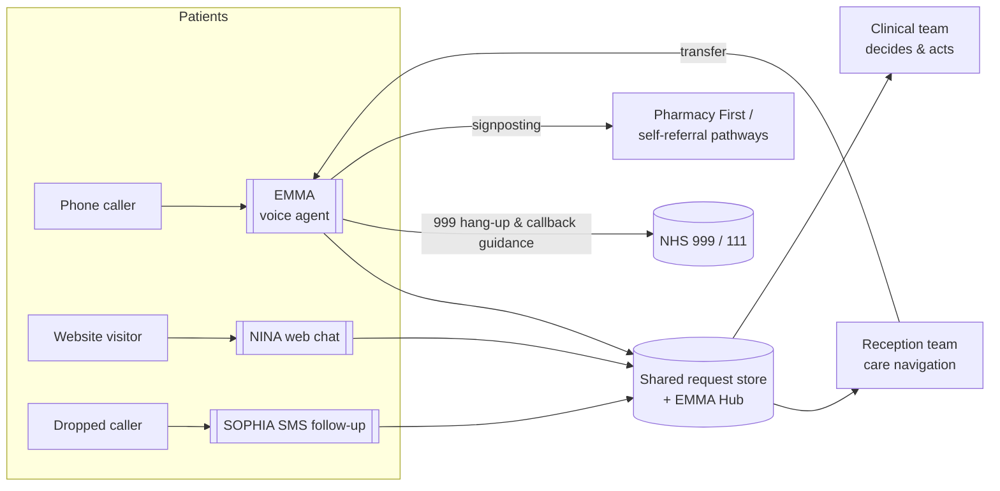

# EMMA_PRODUCT_ANALYSIS.md

**Scope:** Complete product-behaviour analysis of EMMA (and the EMMA/SOPHIA/NINA communication ecosystem), derived from QuantumLoopAI's published helpdesk, site and blog content, plus NHS context. Accessed 5 Nov 2026.
**Labels:** `[DOC]` = documented EMMA behaviour (company-published) · `[REC]` = my recommendation for the prototype, explicitly *not* a documented EMMA capability · `[CTX]` = NHS/primary-care context from third-party public sources.

---

## 0. EMMA positioning as a system (not a chatbot)

EMMA is an **AI telephone receptionist and patient access layer for NHS GP surgeries**, live during **surgery hours**. Documented product shape `[DOC]` [who-is-emma, gp-surgeries-benefits]:

- Answers calls on the practice's **ported reception line**; practice keeps account of the number and workflow ownership.
- **Collects information and sends patient requests into the practice's consultation workflow** (Accurx named as the exemplar integration; "connects to any tool that follows NHS standards").
- **Books/cancels routine appointments within the practice's agreed rules and permissions.** Actions vary per practice configuration.
- Supports **repeat prescription requests**, service/pathway signposting (physiotherapy, **Pharmacy First**, mental health, sexual health), directions and service details, self-booking where offered.
- **Escalates and hands over to humans** per the practice's agreed human-support design; clinical decisions stay with the practice.
- Records every call: **EMMA Hub** shows recordings, transcripts, submissions, and business intelligence.
- **19 languages** signed off via the company's Clinical Safety Officer process (not independent NHS certification).
- **Does not access patient records, prescribing systems, or medication history** — EMMA captures what the patient says and passes it to the practice. (Critically important guardrail.)
- Detects **emergency red flags**; instructs patient to hang up and call 999 straight away. Internal (CSO-signed) evaluation reports **99.6% red-flag detection** — presented as internal, not independently validated.
- **Outbound calling is in beta**; not fully released.
- Disconnected-call follow-up is handled by **SOPHIA (also spelled "SOFIA" on the products helpdesk page — naming inconsistency on the site)** by SMS.

---

## 1. The three-product ecosystem

### 1.1 EMMA — AI telephone receptionist

| Dimension | Analysis |
|---|---|
| Purpose | Zero-queue, 100%-answered phone access for GP practices; structured request intake into existing practice tooling. |
| Problem it solves | The 8am queue/wave: thousands of patients, three receptionists, engaged tones, unanswered calls, patient abuse of staff (see Conisbrough before-state: 1,523 unanswered calls/month, 18-min waits) `[DOC]` case study. |
| Users | Patients (and carers calling for patients — e.g. "my father's appointment…"); reception/admin team; practice manager (EMMA Hub).
| Input channels | PSTN inbound voice (main); website chat (NINA as companion); SMS follow-up (SOPHIA). |
| Outputs | Encrypted call recording + transcript; structured request records ("clean clinical-grade call notes without abbreviations"); routed phone-transfer; appointment bookings/cancellations within agreed rules; BI/reporting for practice & ICB. |
| Key workflows | Opening hours/location/practice info (via configured knowledge), appointment request/booking/cancel, prescription **request** (admin), test-result **update enquiry** (admin — no result disclosure), care navigation/signposting, human escalation, red-flag emergency handling, disconnected-call handover to SOPHIA. |
| Relationship to siblings | Trunk of the ecosystem; Hub is shared surface; SOPHIA catches its dropped calls; NINA offloads the web channel to reduce call volume. |
| Likely backend & integrations | Telephony platform with WebSocket media streaming; consent-free processing under Art. 6(1)(e) & 9(2)(h) UK GDPR; requests submission into consultation/APP systems (e.g. Accurx), appointment-system adapters per practice; secure UK-hosted storage; call-orchestration rules per practice config. `[DOC claims + inferred architecture]` |
| Limitations & operational risks | Not clinical triage; language coverage limited to sign-off list; per-practice configs create config-drift risk; dependency on telephony forwarding contracts; beta outbound; red-flag detection probabilistic (requires layered defences). |

### 1.2 SOPHIA / "SOFIA" — SMS follow-up assistant

- Pages render both spellings ("SOFIA" on the products page body; "SOPHIA" elsewhere — noted as a data-quality bug in their own content). `[DOC]`
- Purpose: when a call **disconnects before the request is complete**, SOPHIA immediately texts the patient a link to finish the request. `41% average re-engagement` claimed. Messages are scenario-specific (drop vs. patient-chosen continuation). Completed requests flow into practice systems like phone submissions. `[DOC]`
- Users/systems: automated, zero-config per call; practice sees completed submissions in the dashboard.
- Limitations: requires consent-valid mobile contact path; link must never expose health data in the SMS body; delayed-claim risk if phone lacks SMS capability (accessibility consideration `[REC]`).

### 1.3 NINA — website chatbot for surgery sites

- 24/7 web channel; trained on the surgery's own website content; handles service/hours/contact questions, appointment requests, prescription/medication queries, signposting (NHS App, 111, Pharmacy First). **Emergency red-flag detection at every conversation stage** with 999/111 prompts; emergency sessions are locked; keyword suppression prevents repeat nagging. Accessibility: step-by-step flows, push-button quick answers, session timeout to protect data. Submissions appear in the same practice dashboard as EMMA phones. `[DOC]`
- Backend: practice-site content ingestion (RAG over the surgery's website content `[I]`), channel adapters, shared request store with EMMA.

### 1.4 How the three products fit together

One **patient communication ecosystem** around a single practice-config and a single request store:

- **Phone is the front door; web is the off-peak channel; SMS is the safety net.** All three write into one view so "a completed request looks completed and an open one stays open" (a principle their own blog states for multi-request calls). `[DOC philosophy; architecture is my reading]`

---

## 2. Patient call experience (deep dive)

### 2.1 Call arrival & answering
- Patients call the **usual surgery number** — no app, no new interface (digital inclusion by design) `[DOC]`.
- Answering happens instantly and reliably (claimed "within three rings", "100% of calls") `[C]`.
- Concurrent handling: "hundreds, even thousands of simultaneous callers" — phone capacity is no longer the constraint `[C]`.
- `[REC]` Prototype mirror: answer within 3 rings equivalent (<500 ms before greeting), and never restrict to a queue.

### 2.2 Intent understanding & mixed/ambiguous information
- EMMA must **separate multiple requests in one call** and treat each as its own outcome — their Nov-2026 blog is explicit: count *requests*, not calls; each request needs a documented outcome or next step; a handover can be a legitimate outcome. `[DOC philosophy]`
- Detail capture quality matters more than polish: corrections (spelling a surname, changing a phone number, revising a sentence mid-flow) must land as a **single unambiguous final value** in the record; "a confident-looking record should not conceal an unresolved question". `[DOC philosophy]` [corrections blog]
- Ambiguity handling `[REC from their philosophy]`: ask clarifying question; if still unclear, record the value as **provisional with a flag**, not silently resolved.

### 2.3 Turn-taking, interruptions, silence, disconnects
- Bararge-in: when the patient talks over, EMMA's own VOI design for demos stresses streaming + "clear"/flush semantics on the telephony side; their Technical Lead JD requires "ASR→LLM→TTS with low-latency streaming and **graceful fallback handling**". `[V]` (JD)
- Silence: telephony config exposes `SilenceTimeout`/`SilenceAction` (notify/hangup) — the product must tolerate silence and re-prompt rather than hang up abruptly `[V]` (Exotel extension guide) + `[REC]` reassurance prompt >8s.
- Disconnect mid-request: SOPHIA SMS follow-up (above) `6% re-engagement` benchmark; prototype mirrors this as a **web/SMS-shaped follow-up link** stored in call state `[REC-adapter to documented capability]`.

### 2.4 Voice, language and accessibility
- 19 languages signed off via CSO process; "all major NHS languages"; elderly/inclusivity is a recurring blog theme ("Older Patients Aren't the Problem. The Design Is."). VIP list at Conisbrough routes elderly/speech-impairment/hearing-loop patients **straight to humans**. `[DOC]`
- Requirements from that: barge-in tolerant, slow-speech friendly, DTMF fallback ("press 1 at any time…") and language switch on greeting. `[REC]`
- Accents: dedicated blog post on accent robustness — implies conservative ASR configuration and explicit re-confirmation loops rather than clever guessing. `[DOC philosophy→REC]`

---

## 3. GP-practice workflow catalogue (workflow cards)

Format: **Patient says** → **Agent behaviour** → **Required info** → **Backend actions** → **Response (voice)** → **Failure conditions** → **Safety notes**. All flows are for **administrative** handling; nothing is clinical.

### W1 Practice information (opening hours / address / phone)
1. *"What time do you close on Fridays?"*
2. Agent answers from practice-configured knowledge (RAG over practice website helpdesk content, mirroring NINA's "trained on the surgery's own website content" `[DOC]`).
3. Required: full weekly hours, bank-holiday notes.
4. Backend: none essential; log topic telemetry; RAG citation recorded in trace.
5. Response: "We're open 8:00 to 18:30 on Fridays…" + self-serve options (online forms, repeat line).
6. Failure: knowledge gap → "I'm not certain; let me take a message for the team" (never confidentially guessed).
7. Safety: pure admin; no health content.

### W2 Appointment request (non-urgent)
1. *"I need to see a doctor about a painful ankle — tomorrow if possible."*
2. Agent captures: who (name/DOB `[REC: identity fields per practice config]`), rough concern stated *for routing only*, preference (GP/nurse, date/time window), contact path.
3. Backend: creates **appointment request struct** in NestJS `POST /requests/appointments` (practice analogue of "sends to the consultation workflow"); **does not invent slot availability** unless a mock booking API is configured (EMMA books within agreed rules) `[DOC]`.
4. Response: confirms capture, next steps, and that the practice will run a request — OR, if mock-pim/system is configured with a real mock schedule, offers the slot(s).
5. Failure: missing name/DOB → targeted clarifiers; transcript-degraded words (names/dates) → confirm via re-ask or take last-good value as provisional.
6. Safety: concern field is free-text **routing metadata only**; no advice, no severity ranking, no "you'll be seen today". Urgency detected → W8.

### W3 Appointment cancellation / reschedule
1. *"I can't make Tuesday's appointment."*
2. EMMA books/cancels **within practice-agreed rules**; if rules prevent it (appointment type locked, GP-only change), agent captures cancellation request for the team.
3. Backend: `POST /requests/appointment-changes` with original appointment reference if known by patient (date/time at minimum).
4. Response: "I've recorded your cancellation; the team will confirm the slot release. Would you like me to request a new time as well?" (classic multi-request catch).
5. Failure: patient unsure of which appointment → offer, "If you're not sure, I'll pass this to the team with what you've told me."
6. Safety: never state which clinician sees the replacement.

### W4 Prescriptions (administrative only)
1. *"Can I order my inhaler repeat?"*
2. Record request item set + matching patient identity; pass to practice's usual repeat-processity (online repeat tooling / NHS App signpost, per practice). `[DOC: supports repeat prescription requests…]`
3. Backend: `POST /requests/prescriptions` (items, identity, delivery/collection, NHS App candidate) — **no medication records touched**.
4. Response: confirms capture + typical turnaround as stated by practice config; signposts Pharmacy First for minor-illness supply where practice enabled it `[DOC: pathway signposting]`.
5. Failure: patient indicates symptoms rather than repeat ("it's not working anymore") → **stop; treat as clinical enquiry → escalate/111/care navigation**, not a prescription transaction.
6. Safety: EMMA must never issue medical advice about any medicine ("couldn't claim", "never advise dosage")

### W5 Test results (administrative status enquiry, never results disclosure)
1. *"Are my blood results back yet?"*
2. Determine whether results are returned; the safe administrative answer is capture + handover or signpost (NHS App / practice where patients can see own record).
3. Backend: `POST /requests/results-enquiry` with test name/date if known; callback request.
4. Response: can never read out results. Typical safe pattern `[REC aligned to [DOC] "test results" admin list item]`: "Results go through the clinical team — I can't share them by phone. I've passed your enquiry on; they'll contact you, or you can view them in the NHS App / ask the reception team."
5. Failure: caller stresses urgency ("I've had them days!") → offer human transfer (W7) or 111 if `[red flag]` triggered.
6. Safety: **hard-coded, prompt-level barrier** on result disclosure; recording single captures for CQC audit trail.

### W6 Registration / admin / directions
1. *"I've just moved here. How do I register? What's your address?"*
2. Info from knowledge (registration pack, steps, forms; opening times; directions; PCP link).
3. Backend: none; or `POST /requests/registration-pack` mail/email listing if configured.
4. Response: concise guided answer + follow-up link (SOPHIA-style `[REC]`) to take the registration details down.
5. Failure: knowledge miss → log + message to team (documented "where to find registration" is a multi-request blog example `[DOC]`).
6. Safety: nil beyond standard privacy of identity data.

### W7 Human-escalation ("Can I speak to a person?")
1. *"No — I want a real person."*
2. Transfer to practice reception/available person quickly; **follow handover to its destination** (their handover blog: patient question "Am I waiting for someone?", "Will I need to explain it again?" must be answered). `[DOC philosophy]`
3. Backend: `POST /transfers` with TT summary; transfers status reviewed as separate KPI (requested/attempted/completed — the blog demands measuring *completed* handovers).
4. Response: promise + honest hold/message option: "Of course — I'll put you through now; I've told them what you've told me, so you'll probably need to repeat yourself less."
5. Failure: no one accepts → message-taking + SOPHIA-style follow-up, and the request stays visibly open on the Hub board ("Can staff see a waiting or unfinished request?" — blog).
6. Safety: no AI pretending a human answered. Never refuse (persistence is allowed, "the small number of patients who specifically request a human get transferred straight away" `[C]`).

### W8 Emergency red-flag
1.*"chest pain/shortness of breath/serious bleeding/mental-health crisis…"
2. Stop the workflow; limited, **pre-approved, universal script**: tell them to hang up and call **999 straight away** (documented exact EMMA instruction "patient is told to hang up and call 999 straight away" `[DOC]`, mirrors NINA "999 or 111" platform behaviour `[DOC]`). Also 111 non-999 pathway for urgent but not immediately life-threatening enquiries `[REC calibrated to [C] FAQ that directs "999 or 111" for urgent enquiries]`.
3. Backend: flag the call record as **emergency-detected**; CSO-auditable trace; lock from further flow state.
4. Response: short, direct script only (keyword generators deny the model the ability to chat).
5. Failure: detection is probabilistic — mitigations `REC`: keyword/pattern pre-filter guarding that runs **before** LLM, plus prompt-level instructions, plus ask-first redirect on any emergent cues, plus demo never trades speed for recall.
6. Safety: neither EMMA's 99.6% nor any number in this prototype shall pass as a clinical guarantee `[DOC: internal evaluation ≠ validation]`.

### W9 Ambiguous / gibberish / intermittent ASR
1. `*silence, partial words, noisy speech`*
2. One clarifying re-ask ("Sorry, I didn't catch that — did you say you need help booking an appointment?") then offer DTMF (`press 1 to request an appointment…`) and finally a transfer/take-message rather than faking success → `[DOC: 'failed speech recognition' operational requirement; Deferred & VI list culture supports this]`
3. Backend: log `asr_confidence` per turn, decayed transcript quality flag on the call record.
4. Response: helpful, no robotic repeat loops beyond once/twice.
5. Failure: `media` stream stops → call-state transitions to `disconnected-pending-SOPHIA` (`[REC]`).
6. Safety: never emit a hallucinated confirmation of a mumbled word (`[DOC philosophy from corrections blog]: a confident record must not conceal doubt`).

---

## 4. Clinical-safety frame for an AI receptionist

1. **Role boundary (documented):** EMMA "does not provide medical advice, diagnose, or perform clinical triage"; practice owns clinical decisions. AI = access & admin. `[DOC]`
2. **Consequence model:** treat each conversation turn's *risk classes* as: (a) admin-safe; (b) needs human; (c) emergency. Class (c) always wins. The red-flag detector runs as the outermost ring at every turn, not as one option among workflows. `[REC consistent with DOC]`
3. **What the agent must never claim/do (`REC` guardrail list for prompts and tests):** no medical/diagnosis/medication advice; no result disclosure; no triage classification ("you're urgent/non-urgent"); no NHS-approval status ("NHS approved" as a statement — even though QuantumLoop marketing footer does use "NHS Approved", a prototype must never); no invented appointment availability; no promise of callback SLAs; no claim that this is their famous EMMA product.
4. **Governance wrapper (documented standard):** DTAC; DCB0129/DCB0160 hazard-log discipline means **every** workflow change has an identified hazard + mitigation + owner + test. `[V]` for the standards' format (NHS England public). The prototype mirrors it at small scale: a hazards.md + release checklist. `[REC]`
5. **Consent/notice for recording** (a recording disclosure at greeting) is standard GP telephony etiquette and matches EMMA's recording-led workflow. `[REC]` + `[CTMA general UK practice]`

---

## 5. Operational requirements the product implies

| Requirement | Documented/basis | Prototype interpretation |
|---|---|---|
| **Answer anytime, queue-free** | 100%/3-ring claims `[C]` | No queue; WS concurrency demo with 3 simulated callers |
| **Low end-to-end voice latency** | Technical-Lead JD: low-latency streaming ASR→LLM→TTS `[V]` | Target: first-plugin TTS chunk ≤ ~1.2–2 s after end of speech (see EVALUATION_PLAN). prototype, not production, threshold |
| **Barge-in/interruption** | clear/flush telephony events `[V]`(Exotel) | WSAudio gate playing VAD to send `clear` and refill mid-sentence |
| **ASR failure modes** | call blog: noise, accents, correction needs `[DOC]` | Clarify-then-DTMF-then-cascade; confidence metrics per turn |
| **Failed model call/timeouts** | Technical Lead JD "graceful fallback handling" `[V]` | Timeout → apologise, hold/transfer; responses never generated mid-air without the model |
| **Call recording & transcripts** | every call recorded/transcribed/auditable `[DOC]` | Rec + transcript JSON per turn, stored per call, surfaced on Hub UI |
| **Immutable audit trail** | Zero-trust/immutable audit logs claim `[C]` | Append-only JSONL per call + trace IDs; no destructive edits |
| **Multi-call concurrency** | hundreds/thousands claimed `[C]` | 3 parallel simulated calls; frame every turn with stream IDs (no shared state) |
| **Reliability/failover** | "instant failover routing to the practice's existing phone system within seconds" `[C]` | Prototype-level: config crash → telephony default route / voice message; documented only as design intent |
| **Multilingual** | 19 languages (CSO signed) `[C]` | En-GB default + 1 extra-language sample ASR/TTS (Hindi/Urdu demo note) `[REC]` |
| **Data minimisation** | "EMMA does not access records/prescribing history; captures what patient says" `[DOC]` | Prototype collects only caller identity fields; stores mock data; fictions only |

---

## 6. Distilled candidate feature set for the 10-day prototype `[REC]`

**In-scope (mirrors documented EMMA essence):** greeting + recording notice; open-hours/address/practice-info via RAG over a *fictional* practice KB; appointment *request* capture (+ mock booking in a tiny fake schedule); cancel/manage-request capture; repeat-prescription request capture; test-results enquiry handling (disclosure-blocked); human-handover intent (mock transfer with transfer summary); red-flag hard-stop prompt; multi-request capture with per-request outcomes; patient-detail corrections (final-value semantics); interruption/silence handling; disconnect follow-up (SOPHIA-shaped web/SMS-like link mock); Hub-style dashboard (call list, transcripts, requests, red-flag flags, latency board); audit JSONL + Langfuse traces; eval harness (15 scenarios).

**Explicitly out of scope:** real patient data, availing real GP booking APIs, NHS PDS/contact matching, real SMS sending (free-tier compliant mock), outbound calling, clinical triage logic of any kind, "NHS approved" language, real records integrations (Accurx matched).

This scope fulfils the essence statement in the JD: "the LLM and RAG systems that power **our chatbot, voice agent and telephony services**" `[V]` — i.e., prove the intelligence core EMMA apps are built on, not the whole commercial estate.
