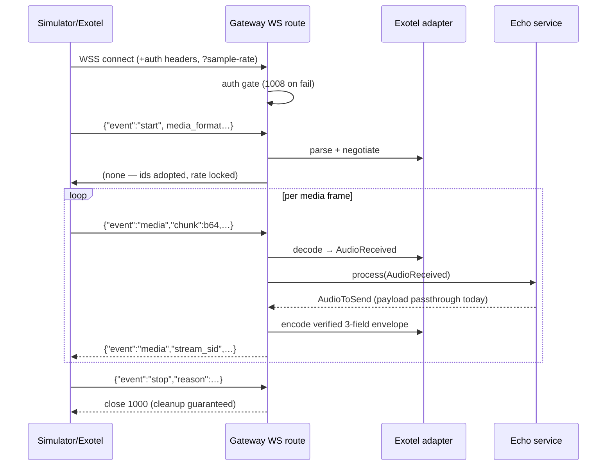

# Day 2 — implementation architecture (voice gateway foundation)

Status: implemented & tested (105 automated tests, simulator smoke run).
Scope today: **engineering foundation + echo path only**. No STT / LLM / RAG /
TTS / booking / dashboard — those are Days 3–8 work.

---

## 1. What was built

```
apps/voice-gateway
├── app
│   ├── api/routes        WS `/ws/exotel` orchestration + `/health/live|ready`
│   ├── core              config (env), JSON logging w/ redaction, lifecycle/registry
│   ├── domain            provider-independent events, audio model, session bookkeeping
│   ├── integrations/exotel  verified AgentStream adapter (schemas · codec · adapter)
│   └── services          echo service (defines the Day-3 pipeline seam)
├── tests                 105 tests: unit + true-uvicorn integration suite
├── pyproject.toml / uv.lock / Dockerfile
scripts/websocket_simulator.py   provider-role simulator (simulation|exotel modes)
infrastructure/docker            gateway-only compose file (no DB/services)
docs/                            protocol verification · runbooks · this document
packages/contracts               placeholder for cross-service contracts (Day 3+)
```

Design rules enforced today:

* **Adapter isolation** — only `app/integrations/exotel/*` knows Exotel JSON.
  A Twilio/Plivo adapter would implement the same `parse_inbound → domain
  event` and `AudioToSend → wire` ops; `echo_service` and route stay untouched.
* **Domain purity** — `app/domain/*` imports nothing from integrations
  (enforced by a test reading module sources).
* **Transport-lite routes** — `websocket.py` coordinates; parsing/negotiation
  stay in the adapter; audio behaviour stays in services.

## 2. Session lifecycle (per WebSocket connection)

1. `accept` (uvicorn WebSocket).
2. **Auth gate** — mode-split (`X-WS-Token` in simulation vs verified Basic
   header in live mode, constant-time compare). Failure → close 1008.
3. **Capacity gate** — `MAX_CONCURRENT_SESSIONS` → close 1013.
4. **Query negotiation** — `?sample-rate=` validated against the verified set
   (8000/16000/24000) → otherwise close 1008.
5. `pending-<uuid>` session registered in `GatewayState.registry`.
6. Message loop (strict ping-pong):
   * non-text / malformed / invalid-payload → tolerance budget (default 5) →
     break & close 1003;
   * oversized message → immediate close 1009;
   * `connected` → logged (event belongs to the platform);
   * `start` → strict media negotiation (1008 on unsupported), provider ids
     adopted (`session.adopt_stream`), registry re-keyed, `CallStarted` fact;
   * `media` → base64 decode → `AudioReceived` → `echo_service.process` →
     `AudioToSend` → outbound 3-field envelope → send (peer-gone safe);
   * `stop` → logged, close 1000;
   * `dtmf`/`mark`/unknown → logged only (value-safe logging).
7. **Cleanup guarantee** — `finally`: registry unregistration (idempotent) and
   session-closed log with counters in every exit path (normal, abrupt, error).

Close-code table (our chosen policy) lives in
`docs/integrations/exotel-protocol.md` §2.



## 3. Domain event model (provider-independent)

`app/domain/events.py` — frozen Pydantic models:

* `CallStarted` — negotiated context (ids, custom_parameters, audio_format).
* `AudioReceived` — one decoded inbound frame (`payload`, `sequence`,
  `provider_chunk_id/timestamp`, `audio_format`).
* `AudioToSend` — a frame the gateway must deliver (`request_sequence` marks
  the inbound frame it answers, so a future streaming pipeline can express
  ordering without renegotiating the wire).
* `CallEnded` / `ConnectionClosed` — termination facts with close codes.

`app/domain/audio.py` — `AudioFormat(encoding, sample_rate, channels)` with
strict validation aliases (PCM/Linear16 ⇒ `PCM_L16`), verified-rate set, and
byte→ms helper for diagnostics.

## 4. Echo service — the Day-3 seam

`app/services/echo_service.py` implements `AudioReceived → AudioToSend`
byte-preserving. The pipeline swap (no transport changes needed):

```
AudioReceived ─► [VAD]  endpointing + barge-in gate  (Day 3, Azure/local VAD)
            ─► [STT]  Azure Speech F0 streaming STT    (Day 3)
            ─► [LLM]  Gemini Flash + fallback adapters (Day 4)
            ─► [TTS]  Azure Speech F0 synthesis        (Day 3)
            ─► AudioToSend stream
```

Latency budget (from Day-1 ADRs) to defend on Day 3:
end-of-speech → first TTS frame p50 ≤ 1.5 s / p95 ≤ 2.5 s, with `clear`
barge-in ≤ 200 ms (verified mechanism [V7]; not wired today since echo has no
playback queue).

Notably preserved design head-room:

* `audio_format` rides on every event — resampling stays a service decision.
* `AudioToSend.request_sequence` — ordering bookkeeping already typed.
* Session counters (`frames_in/out`, bytes) already power `/health/ready` and
  will back the Day-7 eval harness.

## 5. Configuration surface

| Env var | Default | Purpose |
|---|---|---|
| `APP_ENV` / `APP_HOST` / `APP_PORT` / `LOG_LEVEL` | development / 0.0.0.0 / 8000 / INFO | process basics |
| `EXOTEL_MODE` | simulation | simulation ↔ live protocol switches auth + expectations |
| `EXOTEL_API_KEY` / `EXOTEL_API_TOKEN` | unset | live-mode Basic header; readiness degrades if missing |
| `WS_AUTH_TOKEN` | unset | simulation-mode `X-WS-Token`; unset = open local dev |
| `MAX_WS_MESSAGE_BYTES` | 262144 | WS hard limit (close 1009) |
| `MAX_CONSECUTIVE_ERRORS` | 5 | malformed-frame tolerance budget (close 1003) |
| `MAX_CONCURRENT_SESSIONS` | 200 | overload guard (close 1013) |
| `EXOTEL_MAX_CHUNK_BYTES` | 100000 | decoded-chunk cap (verified max, tolerance path) |

Deliberate omissions: `EXOTEL_SUBDOMAIN`/`EXOTEL_ACCOUNT_SID` (only needed for
outbound Exotel APIs — none exist yet), any STT/LLM/TTS keys (out of scope today).

## 6. Testing strategy

* **Unit** — codec strictness (incl. base64 edge cases), schema tolerance
  (`extra="ignore"` + aliases), adapter negotiation failures, echo purity,
  settings validation, JSON-log redaction, registry idempotency.
* **Integration (real uvicorn + websockets client)** — health structure, full
  echo round-trip, exact outbound envelope shape, in-order multi-frame
  ping-pong, abrupt disconnect & concurrent-session cleanup via
  `/health/ready`, malformed/unknown/binary tolerance vs budget (1003),
  oversized (1009), negotiation rejects (1008), auth failure paths
  (simulation token; live Basic incl. wrong scheme), stop→1000-with-reason.
* Chose a real uvicorn harness after discovering starlette 0.162's TestClient
  regressed on server-initiated close codes (documented in conftest).

## 7. Deliberately postponed (today ≠ them)

* Streaming STT/TTS & VAD (Day 3), LLM orchestration + practice context
  (Day 4), RAG (Day 5), dashboard (Day 6), eval harness (Day 7), demo record
  (Day 8–9).
* `clear` barge-in: protocol-verified, implementation deferred until a playback
  queue exists (currently the answer path is instantaneous echo).
* Outbound Exotel REST/API usage (hence no subdomain config).
* Browser-facing CORS (no dashboard client yet).
